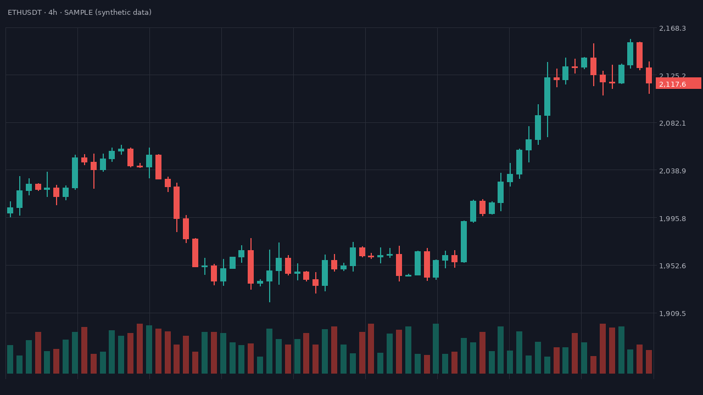
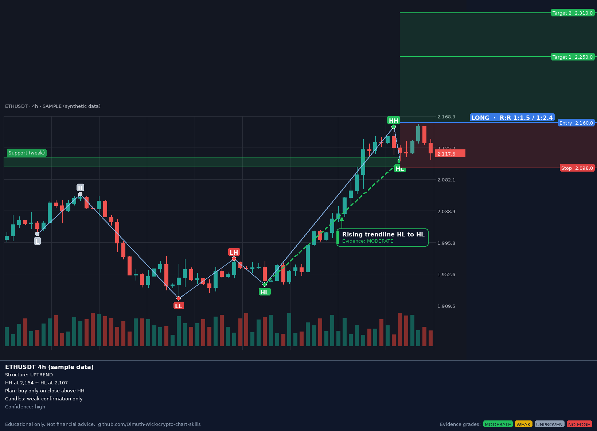
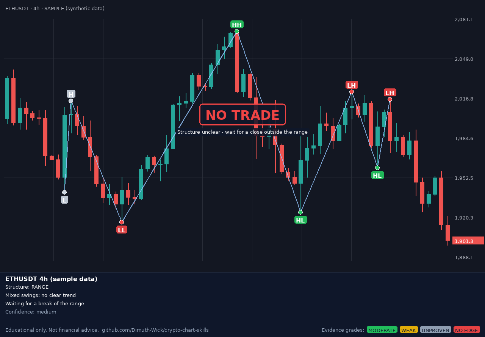

# crypto-chart-skills

**An evidence-graded chart-reading skill for AI agents (Claude, Codex and other tools that load `SKILL.md` skills).**
Give it a crypto chart screenshot. It marks the swing pivots (HH / HL / LH / LL),
draws the market structure and any clear pattern **with its research grade**,
and adds a risk-first trade plan, or a **NO TRADE** stamp when the chart is unclear.

| Input screenshot | Output |
|---|---|
|  |  |

When there is no clean setup, the skill says so:



*Sample images use synthetic data.*

> ⚠️ **Educational only. Not financial advice.** Most chart patterns have weak
> evidence, and even frontier AI models lost money in live trading tests.
> Never risk money you cannot afford to lose.

---

## Why evidence grades?

Before building this, I reviewed the research on AI in crypto trading and on chart
patterns ([full report](docs/research.md)). The short version:

| Signal | Grade |
|---|---|
| Market structure (HH-HL / LH-LL), range and triangle **breakouts** | 🟢 Moderate |
| Head & shoulders, double tops/bottoms, support/resistance | 🟡 Weak |
| Triangles before breakout, flags, wedges | ⚪ Unproven |
| Candlestick patterns | 🔴 Mostly no edge |

So the skill leads with structure, shows every pattern's grade on the chart, and
treats "NO TRADE" as a normal answer.

## How it works

```
screenshot ──► detect (Python)            ──► Claude/Codex reads the result  ──► draw (Python)
               finds candles by colour,        checks structure, names a          pivots, structure,
               swing pivots, HH/HL labels,     pattern only if clear, grades      graded pattern,
               trend, break of structure       it, applies risk rules             plan or NO TRADE
```

The script snaps every pivot to a real candle wick, because general vision
models are not precise at reading exact positions on candlestick charts.

## Install

1. Download this repo (green **Code** button → *Download ZIP*) or `git clone` it.
2. Copy the folder `skills/chart-reader` into your agent's skills folder:
   - **Claude Code**: `~/.claude/skills/chart-reader` (or `.claude/skills/` inside a project)
   - **Claude app**: zip the `chart-reader` folder and upload it as a skill in Claude's settings
   - **Codex**: `~/.codex/skills/chart-reader`
   - Other agents: any tool that reads `SKILL.md` skills
   (If your tool uses a different path, check its docs.)
3. Install the two Python libraries: `pip install -r requirements.txt`
4. Share a chart screenshot and ask, for example, *"What does this chart show? Any setup?"*

### Recommended timeframes

| Timeframe | Recommendation |
|---|---|
| **4-hour and higher** (4h, 1D, 1W) | ✅ Recommended. Patterns and structure are clearest here |
| **1-hour** | ⚠️ Sometimes works. Use with extra caution |
| **Below 1-hour** (30m, 15m, 5m, 1m) | ❌ Not recommended. Too much noise; patterns often don't make sense |

This comes from my own trading experience, not from the research studies. Lower
timeframes are also where fees, spread and fast bots have the biggest effect.

### Tips for good screenshots
- Use a **4-hour or higher** timeframe (see above).
- Candlestick chart with coloured candles (default green/red works best).
- Hide indicators and drawings on the price pane.
- 40–200 candles visible; the price axis visible on the right.

## Use the script directly

```bash
cd skills/chart-reader
# 1. find candles and pivots (region = price pane only, calib = two axis labels)
python scripts/annotate.py detect chart.png --region 10,50,1190,570 --calib 50:2168.3,570:1909.5 > detect.json
# 2. draw your annotations (see references/spec-format.md)
python scripts/annotate.py draw chart.png spec.json --detect detect.json --calib 50:2168.3,570:1909.5 -o out.png
# 3. position size and risk/reward
python scripts/annotate.py size --account 1000 --risk-pct 1 --entry 2160 --stop 2098 --targets 2250 2310
```

Try it on a generated chart: `python examples/make_sample_chart.py test.png`

## Repository layout

```
skills/chart-reader/
  SKILL.md                     instructions the agent follows
  scripts/annotate.py          detect / draw / size
  references/evidence-grades.md  grade for every pattern
  references/patterns.md       how each pattern is recognised and confirmed
  references/risk-rules.md     when to plan, when to say NO TRADE
  references/spec-format.md    JSON format for drawing
docs/research.md               the research behind the grades (with sources)
examples/                      sample charts and a synthetic chart generator
tests/                         pytest tests on synthetic charts
```

## Limitations

- Tested on synthetic charts. Real screenshots vary; check the detected pivots.
- Needs coloured candles. Hollow, line or Heikin-Ashi charts may detect poorly.
- Linear price axis only for price calibration.
- The last few candles cannot be confirmed pivots yet.
- Grades come from a limited set of studies and will change as evidence changes.

## Contributing

Issues and pull requests are welcome, especially new studies that support or
change a grade (please include the source), and screenshots where detection fails.

Run the tests: `pip install -r requirements-dev.txt && python -m pytest tests -q`

## License

[MIT](LICENSE) © Dimuth-Wick. Provided "as is", without warranty. You are
responsible for your own trading decisions.
